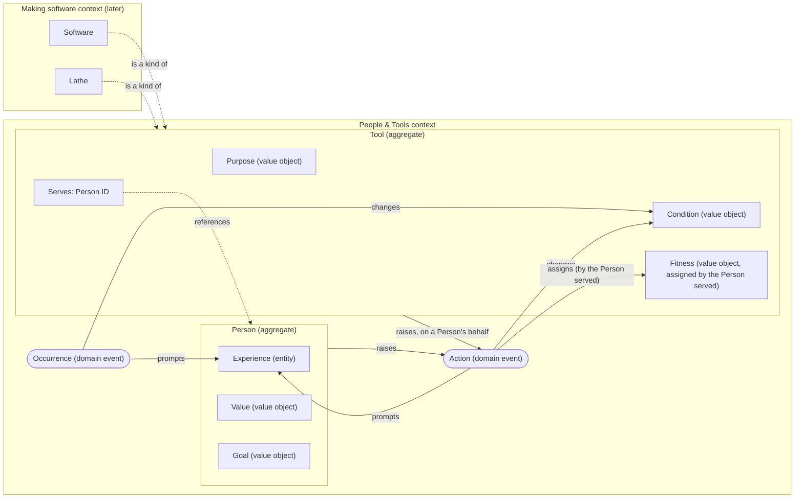

# Lathe: Domain Model

The domain model as a diagram. It's written in Mermaid, a text format that GitHub and most editors render as a picture, so we can change it by editing text. Terms are defined in [NOTES.md](NOTES.md).

## How to read it
- **Boxes inside a frame** belong to that aggregate.
- **Rounded shapes** are domain events: records that something happened.
- **Solid arrows** show what raises or prompts what. **Dotted arrows** are references or "is a kind of".
- The **Making software context** sits outside the foundational context and builds on it.
